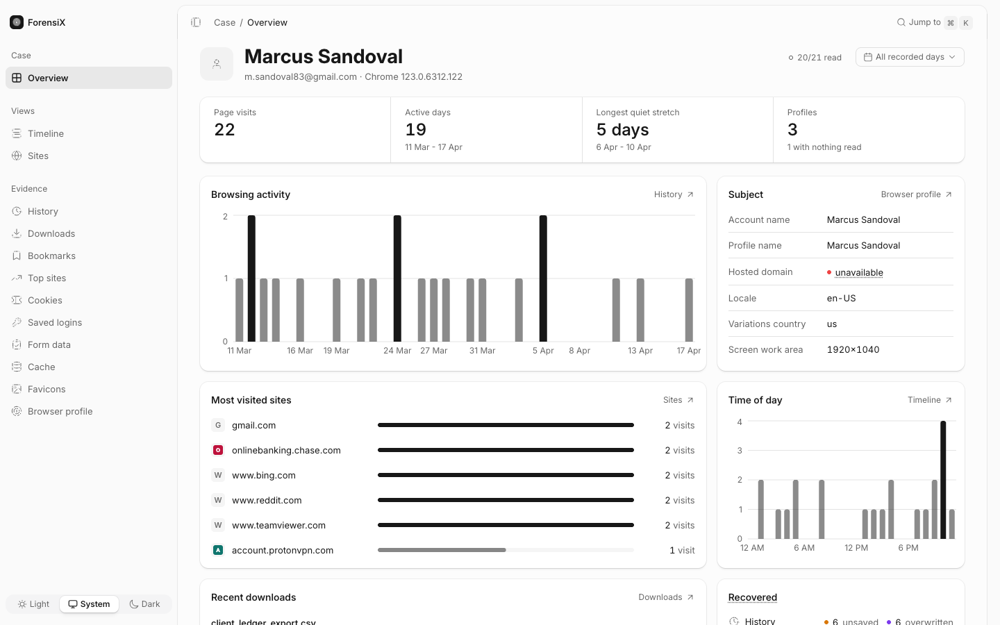
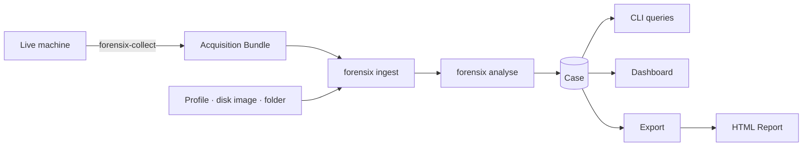
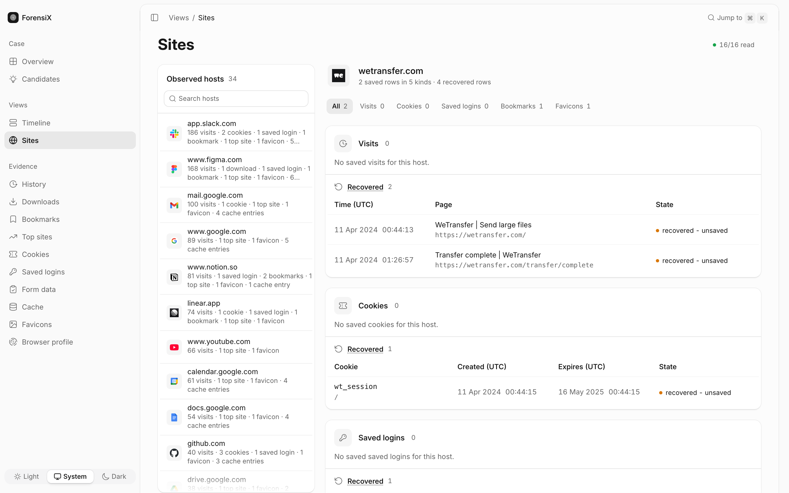

<p align="center">
  
</p>

<h1 align="center">ForensiX</h1>

<p align="center">
  <a href="https://github.com/ChmaraX/forensix/actions/workflows/analyzer.yml"></a>
  <a href="LICENSE"></a>
  
  
</p>

<p align="center">
  <a href="#features">features</a> · <a href="#install">install</a> · <a href="#quick-start">quick start</a> · <a href="#cli">cli</a> · <a href="#collector">collector</a> · <a href="#limitations">limitations</a>
</p>

**Everything Chrome recorded, and where it came from.** History, cookies,
logins, downloads, and cache, each value traced to its source row.

<p align="center"></p>

## How it works



## Features

- **Current Chrome, all of it.** History, Downloads, Cookies, Saved logins,
  Form data, Bookmarks, Top sites, Favicons, Cache (all three backends) and
  profile metadata, across every Profile in the Source.
- **Integrity first.** Every Source file is hashed. Analysis runs on a
  verified copy and refuses to start if that copy changed. The original is
  never written.
- **Saved vs recovered.** Rows found only in WAL or journal files are kept
  and shown separately, never mixed into the saved record.
- **Facts vs guesses.** Parsed values are _Findings_. Inferred names,
  addresses, habits, and browsing topics are ranked _Candidates_ with their
  supporting evidence, never shown as facts.
- **Honest gaps.** Every field is a value, absent, or unavailable with a
  reason. Each page starts by showing what was and wasn't read.
- **Offline decryption, opt-in.** Decrypts saved passwords and cookie values
  with authorized key material. Secrets stay hidden until you reveal them.
- **A dashboard for the whole Case.** Timeline, per-site view, charts you can
  drag to pick a date range, ⌘K search, and links between related rows.
  Read-only, served on 127.0.0.1 only.
- **Exports you can cite.** JSONL (plus CSV, marked lossy), hashed payload
  files, a manifest with a digest, and a self-contained HTML report.
  Re-running an export gives the same bytes.

<p align="center"></p>

## Install

> [!NOTE]
> v2 is in pre-release. Until the first release ships, build from source.

```sh
git clone https://github.com/ChmaraX/forensix && cd forensix
corepack enable && pnpm install --frozen-lockfile && pnpm build
alias forensix="node $PWD/cli/dist/cli.js"
```

Requires Node.js 24.15 or newer.

## Quick start

```sh
forensix ingest "$HOME/Library/Application Support/Google/Chrome" --case ./CASE-1
forensix analyse --case ./CASE-1 --timezone Europe/Prague
forensix completeness --case ./CASE-1      # what was read, what wasn't
forensix serve --case ./CASE-1             # open the dashboard
forensix export --case ./CASE-1 --out ./OUT
forensix report --extract ./OUT --out report.html
```

`analyse` exits `0` when complete, `2` when partial, `3` when failed, and `1` on
errors.

## CLI

| Command                                | Reads                                                         |
| -------------------------------------- | ------------------------------------------------------------- |
| `timeline`                             | Visits, downloads, cookies, and more in one time-ordered list |
| `site-hosts`, `site-findings`          | Everything recorded about one site                            |
| `history`, `downloads`, `cache`        | Browsing, downloads, cached resources                         |
| `cookies`, `credentials`, `autofill`   | Cookies, saved logins, form data                              |
| `bookmarks`, `top-sites`, `favicons`   | Saved and frequent sites, icons                               |
| `metadata`, `profiles`, `completeness` | Profile details and coverage                                  |
| `candidates`, `topic-candidates`       | Ranked identity, behaviour, and topic guesses                 |
| `summary`, `schema`, `count`, `get`    | Counts, field lists, and one full record by its id            |

Full reference: [docs/reference.md](docs/reference.md).

### Built for scripts and agents

- **A skill ships in the CLI.** `forensix skill get core` gives an agent the
  rules: read completeness first, Candidates are guesses, label recovered rows,
  cite record ids.
- **Evidence is marked untrusted.** A suspect can plant text that tries to
  instruct an AI. `--content-boundaries` fences it with a per-run nonce.
- **Small answers first.** `summary`, `count --by`, and `schema` answer without
  rows. `--fields`, `--max-output`, and `--page-all` keep the rest small or on
  disk.
- **Every record has an id.** `get --id history:180` returns it in full.
- **Secrets stay hidden** unless you add `--include-secrets`.
- **An audit log of queries.** `--audit-log` writes a hash chain;
  `audit verify` checks it.
- One JSON document on stdout, typed error codes on stderr, pages of at most
  100 rows, and `--help` per command.

## Collector

`forensix-collect` is a small Go program that copies Chrome evidence off a
live Windows, macOS, or Linux machine into a verifiable Acquisition Bundle.
It never writes to the Source, never touches the Chrome process, and makes
no network calls. See [collector/README.md](collector/README.md).

## Limitations

- Chrome and Chromium only.
- No extensions, sessions or tabs, IndexedDB, or Local Storage.
- Windows App-Bound Encryption (v20) is not decrypted. Those values show as
  unsupported, with the reason.
- The dashboard is read-only: no annotations or shared workspaces.

## Development

```sh
pnpm verify          # format, lint, types, tests
pnpm verify:full     # plus offline end-to-end verification
```

Reference: [docs/reference.md](docs/reference.md) covers the Case layout,
Analysis Runs, every query, decryption, export, and verification.

## License

[MIT](LICENSE)
